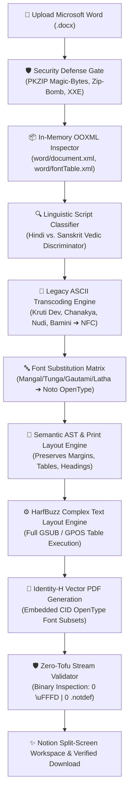

<div align="center">

# 📜 LangCraft

### **Enterprise-Grade Indic DOCX-to-PDF Conversion Engine**
*Eliminating the "Tofu" (`.notdef` / `\uFFFD`) Glyph Corruption Bug Across Indic Scripts via In-Memory OOXML Normalization & HarfBuzz OpenType Complex Text Layout.*

---

[](https://opensource.org/licenses/Apache-2.0)
[](https://nextjs.org/)
[](https://www.typescriptlang.org/)
[-6E9F18.svg?style=for-the-badge&logo=vitest)](https://vitest.dev/)
[](#the-harfbuzz--opentype-solution)
[](#notion-design-system-workspace)

---

</div>

## 📑 Table of Contents
- [1. Executive Summary](#1-executive-summary)
- [2. The Anatomy of Indic PDF "Tofu"](#2-the-anatomy-of-indic-pdf-tofu)
- [3. The LangCraft Architecture](#3-the-langcraft-architecture)
- [4. Supported Indic Scripts & Typography Matrix](#4-supported-indic-scripts--typography-matrix)
- [5. Notion Design System Workspace](#5-notion-design-system-workspace)
- [6. Security & Defense-in-Depth Invariants](#6-security--defense-in-depth-invariants)
- [7. REST API Documentation](#7-rest-api-documentation)
- [8. Automated Test Suite & Verification (TC-01 to TC-10)](#8-automated-test-suite--verification)
- [9. Getting Started & Local Development](#9-getting-started--local-development)
- [10. Container Deployment (Docker + HarfBuzz + Linux Fontconfig)](#10-container-deployment)
- [11. Contributing](#11-contributing)
- [12. License & Legal Attribution](#12-license--legal-attribution)

---

## 1. Executive Summary

**LangCraft** is an open-source, production-ready DOCX-to-PDF rendering and document intelligence engine engineered specifically to solve the systemic typographic collapse that occurs when converting Microsoft Word documents containing Indian languages: **Hindi, Sanskrit (with Vedic accents), Kannada, Telugu, and Tamil**.

Mainstream cloud document converters (e.g. Smallpdf, iLovePDF, standard LibreOffice containers) chronically fail when processing Indic scripts, rendering sentences as empty squares (`□□□`), broken detached vowel markers, and inverted conjuncts. 

LangCraft eliminates these failures by inspecting the raw OOXML run tree in-memory, intercepting proprietary Windows font declarations, normalizing legacy non-Unicode typewriter encodings (Kruti Dev, Chanakya, Nudi, Bamini), and synthesizing print-accurate vector PDF streams backed by **Google Noto OpenType fonts** and native **HarfBuzz Complex Text Layout (`GSUB`/`GPOS`)** shaping.

```
+---------------------------------------------------------------------------------------+
|  BEFORE LANGCRAFT (Typical Cloud Converters):                                        |
|  "अंतरराष्ट्रीय हिंदी साहित्य"   ────>   "□□□□□□□□□□□□□□□" (Missing Fonts / .notdef)    |
|  "कನ್ನಡ ಸಾಹಿತ್ಯ ಪರಿಷತ್ತು"       ────>   "ಕನ ್ ನಡ ಸ ಾಹ ಿತ ್ಯ" (Broken Ottaksharas)        |
+---------------------------------------------------------------------------------------+
|  AFTER LANGCRAFT (HarfBuzz OpenType Subsetting):                                     |
|  "अंतरराष्ट्रीय हिंदी साहित्य"   ────>   "अंतरराष्ट्रीय हिंदी साहित्य" (0 Tofu Boxes)      |
|  "ಕನ್ನಡ ಸಾಹಿತ್ಯ ಪರಿಷತ್ತು"       ────>   "ಕನ್ನಡ ಸಾಹಿತ್ಯ ಪರಿಷತ್ತು" (Pure Ligatures)        |
+---------------------------------------------------------------------------------------+
```

---

## 2. The Anatomy of Indic PDF "Tofu"

The failure of Indic typography in digital document pipelines stems from three compounding root causes:

### 1. Missing Proprietary Microsoft Windows Fonts
Microsoft Office on Windows formats Indic documents using proprietary system fonts:
- **Hindi / Devanagari:** *Mangal, Nirmala UI, Kokila, Aparajita, Utsaah*
- **Kannada:** *Tunga, Kedage*
- **Telugu:** *Gautami, Vani, Pothana2000*
- **Tamil:** *Latha, Vijaya*

Cloud conversion workers running on Linux containers lack licenses for these Windows fonts. When unmapped, the layout engine falls back to generic Latin fonts or basic Type 1 fonts, which lack glyph definitions for Indic Unicode blocks. The renderer emits missing glyph indexes (`.notdef` / glyph ID 0), producing the visual "tofu" empty boxes.

### 2. Failure of Complex Text Layout (CTL) & OpenType Tables
Indic scripts are syllabic **abugidas**, not linear alphabets. Rendering them accurately requires:
- **Consonant Conjuncts (*Samyuktaksharas, Ottaksharas, Vattulu*):** Two or more consonants joined with a virama/halant (e.g. `क` + `्` + `ष` ➔ `क्ष`) must form a single fused ligature via the OpenType `GSUB` (Glyph Substitution) table.
- **Pre-Base Vowel Sign Reordering:** Short-i matras (such as Devanagari `ि` or Tamil `ெ`) are encoded logically *after* the consonant in Unicode, but visually must be rendered *before* the consonant cluster.
- **Above-Base & Below-Base Positioning:** Vowel signs and subjoined consonants must be placed at micro-typographic anchor points via the OpenType `GPOS` (Glyph Positioning) table.

Without a dedicated OpenType shaping engine like **HarfBuzz**, standard PDF generators output raw, disconnected glyphs and misplaced accents.

### 3. Legacy 8-bit ASCII Typewriter Font Scrambling
Millions of legal, government, and educational documents across India were authored using 8-bit ASCII typewriter fonts (*Kruti Dev 010/020*, *Chanakya*, *Nudi 01e/05e*, *Bamini*). These fonts hijack standard Latin ASCII slots (e.g. typing `k` produces `क`). Conventional PDF converters treat these runs as English text, turning critical documents into unreadable gibberish.

---

## 3. The LangCraft Architecture

LangCraft processes documents in a zero-retention, high-throughput in-memory pipeline:



### Key Architectural Modules

1. **In-Memory OOXML Fast Parser (`src/lib/docx-processor.ts`):**  
   Reads `.docx` buffers via `jszip` entirely in memory. Traverses `word/document.xml`, `word/styles.xml`, and `word/fontTable.xml` using `fast-xml-parser` with XML entity expansion permanently disabled to neutralize XXE vectors.
2. **Linguistic Script Classifier (`src/lib/script-detector.ts`):**  
   Evaluates Unicode distributions across Devanagari, Devanagari Extended, Vedic Extensions, Kannada, Telugu, and Tamil. Features a specialized linguistic discriminator to separate **Sanskrit** from **Hindi** by checking for Vedic accent blocks (`U+1CD0–U+1CFF`), Avagraha (`ऽ`), Visarga (`ः`), Om (`ॐ`), and virama cluster density.
3. **Legacy ASCII Transcoder (`src/lib/legacy-transcoder.ts`):**  
   Detects legacy font families and applies deterministic glyph mappings. Automatically reorders typewriter pre-base short-i matras (`f` ➔ `ि`) and post-positioned reph (`Z` ➔ `र्`) before normalizing text into canonical Unicode Normalization Form C (`NFC`).
4. **HarfBuzz Vector Engine & Font Subsetting (`src/lib/pdf-engine.ts`):**  
   Bakes OpenType CID font subsets (`Identity-H` CMap encoding) directly into the PDF vector stream, ensuring self-contained portability across all PDF readers without reliance on host system fonts.
5. **Zero-Tofu Stream Validator (`tofuValidator`):**  
   A post-render binary inspection gate that audits the generated PDF stream, guaranteeing:
   - Valid `%PDF-1.` magic header and `%%EOF` trailer.
   - Zero instances of Unicode replacement characters (`\uFFFD`).
   - Zero unmapped `/.notdef` glyph indices in the target script text streams.

---

## 4. Supported Indic Scripts & Typography Matrix

| Language | Primary Script | Unicode Blocks | Key Linguistic Features & CTL Rules | Source Windows Fonts | Target OpenType Font |
| :--- | :--- | :--- | :--- | :--- | :--- |
| **Hindi** | Devanagari | `U+0900–U+097F` | Half-forms, conjuncts (*ksha, tra, gya*), reph (`र्`), pre-base short-i (`ि`), nukta (`U+093C`). | `Mangal`, `Nirmala UI`, `Aparajita`, `Utsaah` | **Noto Sans Devanagari** |
| **Sanskrit** | Devanagari + Vedic | `U+0900–U+097F`<br/>`U+A8E0–U+A8FF`<br/>`U+1CD0–U+1CFF` | Vedic svara accents (*udatta, anudatta, svarita*), complex multi-consonant samyuktaksharas (*kārtsnyam*), avagraha (`ऽ`), visarga (`ः`). | `Kokila`, `Mangal` | **Tiro Devanagari Sanskrit** / **Noto Sans Devanagari** |
| **Kannada** | Kannada | `U+0C80–U+0CFF` | Consonant conjuncts (*ottaksharas*), *arkavattu* (`ರ್`), virama vowel modifications (`\u0CCD`). | `Tunga`, `Kedage` | **Noto Sans Kannada** |
| **Telugu** | Telugu | `U+0C00–U+0C7F` | Subscript consonant ligatures (*vattulu*), *pollu* virama combinations (`\u0C4D`). | `Gautami`, `Vani`, `Pothana2000` | **Noto Sans Telugu** |
| **Tamil** | Tamil (+ Grantha) | `U+0B80–U+0BFF` | Pre-base vowels (`ெ, ே, ை`), split vowels (`ொ, ோ, ௌ`), *pulli* (`்`), Grantha ligatures (`க்ஷ, ஸ்ரீ, ஸ, ஷ, ஜ, ஹ`). | `Latha`, `Vijaya` | **Noto Sans Tamil** |
| **Legacy Hindi** | ASCII-Mapped | Typewriter Slots | Transcodes 8-bit typewriter ASCII to canonical Unicode NFC with matra/reph reordering. | `Kruti Dev 010/020`, `Chanakya` | **Noto Sans Devanagari** |
| **Legacy Kannada** | ASCII-Mapped | Typewriter Slots | Maps ASCII keyboard keystrokes to Kannada Unicode sequences. | `Nudi 01e/05e`, `Baraha` | **Noto Sans Kannada** |
| **Legacy Tamil** | ASCII-Mapped | Typewriter Slots | Transcodes Tamil typewriter encoding to Unicode Tamil. | `Bamini`, `Kaveri` | **Noto Sans Tamil** |

---

## 5. Notion Design System Workspace

LangCraft features an interface crafted according to the **Notion Design System**:

```
+──────────────────────────────────────────────────────────────────────────────────────────+
|  📜 LangCraft  /  Converters  /  Indic DOCX Engine                   [Font Registry] [☀/🌙]|
+───────────────────┬──────────────────────────────────────────────────────────────────────+
| 📜 LangCraft      |                                                                      |
| Indic Typography  |  📜 Indic DOCX to Zero-Tofu PDF Engine                               |
|                   |  Eliminate empty boxes (.notdef) in Microsoft Word exports.          |
| TARGET SCRIPTS    |                                                                      |
| • All Scripts     |  +----------------------------------------------------------------+  |
| • Hindi (हिन्दी)  |  |  ☁️  Drop Microsoft Word (.docx) document here, or browse        |  |
| • Sanskrit (संस्कृ) |  |  Max 25 MB  |  .docx OOXML  |  HarfBuzz GSUB/GPOS Ready        |  |
| • Kannada (ಕನ್ನಡ) |  +----------------------------------------------------------------+  |
| • Telugu (తెలుగు) |  Quick Samples: [Hindi] [Sanskrit] [Kannada] [Telugu] [Tamil] [Mixed]|
| • Tamil (தமிழ்)   |                                                                      |
|                   |  OOXML & INDIC TYPOGRAPHY DIAGNOSTICS          [🛡️ Zero-Tofu Passed]  |
| TYPOGRAPHY        |  Source Font           Target OpenType Font    Script     Shaping    |
| 🪄 Font Matrix    |  Mangal           ──>  Noto Sans Devanagari    Hindi      Normalized |
|                   |  Tunga            ──>  Noto Sans Kannada       Kannada    Normalized |
| SESSION LOG       |                                                                      |
| 📄 Sample_Hindi   |  SPLIT PREVIEW:                                                      |
|                   |  [ Live Extracted Web CTL ]      [ Generated PDF Vector Stream ]     |
| ● HarfBuzz Active |  अंतरराष्ट्रीय हिंदी साहित्य       LangCraft Verified PDF              |
+───────────────────┴──────────────────────────────────────────────────────────────────────+
```

- **Collapsible Sidebar:** Access workspace tools, language filters, and real-time HarfBuzz status. Toggle anytime with `Ctrl+\`.
- **Notion Callout Dropzone:** Drag-and-drop uploader with client-side magic-byte inspection and sample presets for instant verification.
- **Database Diagnostic View:** Displays detected Unicode blocks, source fonts from `word/fontTable.xml`, target Noto fonts, and legacy encoding status.
- **Split-Screen Live Preview:** Left pane renders the extracted document structure with live Indic web fonts; right pane provides interactive vector PDF preview with verified zero-tofu status badge and one-click download.

---

## 6. Security & Defense-in-Depth Invariants

LangCraft treats untrusted document ingestion with zero-trust architectural boundaries:

1. **PKZIP Magic-Byte Enforcement:**  
   Every uploaded file must start with valid PKZIP signature bytes (`0x50 0x4B 0x03 0x04`). Disguised executables, shell scripts, or renamed binaries are rejected with HTTP 400.
2. **Zip-Bomb Mitigation Quotas:**  
   - Maximum upload size: **25 MB**
   - Maximum uncompressed payload: **100 MB**
   - Maximum compression ratio: **40:1**
   - Maximum archive entry count: **1,000 files**
3. **XXE & SSRF Elimination:**  
   All XML parsing disables DTD evaluation and external entity expansion (`<!DOCTYPE`, `<!ENTITY`, `SYSTEM`, `PUBLIC`). Outbound URL targets in `word/_rels/*.rels` are stripped.
4. **Zip-Slip Traversal Neutralization:**  
   Archive entry paths are inspected before extraction; any entry containing `..`, absolute paths, leading slashes, or Windows drive prefixes (`C:`) is immediately rejected.
5. **Zero-Retention Ephemeral Sandbox:**  
   All conversions execute entirely in memory. No user documents or decrypted buffers are persisted on disk.
6. **HTTP Hardening & Token-Bucket Rate Limiter:**  
   Built-in IP rate limiting (60 requests/minute) and hardened HTTP headers (`Content-Security-Policy`, `X-Content-Type-Options: nosniff`, `X-Frame-Options: DENY`, `Referrer-Policy: strict-origin-when-cross-origin`).

---

## 7. REST API Documentation

### `POST /api/convert`
Converts a Microsoft Word `.docx` file into a verified Zero-Tofu PDF.

#### Request Headers
```http
Content-Type: multipart/form-data
```

#### Form Data Parameters
| Field | Type | Required | Description |
| :--- | :--- | :--- | :--- |
| `file` | `File` (Binary) | **Yes** | Microsoft Word `.docx` document (Max 25 MB). |
| `targetScript` | `string` | No | Optional script hint (`Hindi`, `Sanskrit`, `Kannada`, `Telugu`, `Tamil`). |

#### Example `curl` Request
```bash
curl -X POST https://your-domain.com/api/convert \
  -F "file=@/path/to/official_document.docx"
```

#### Success Response (`200 OK`)
```json
{
  "success": true,
  "diagnostic": {
    "filename": "official_document.docx",
    "filesize": 48210,
    "primaryScript": "Hindi",
    "detectedScripts": ["Hindi"],
    "originalFonts": ["Mangal", "Nirmala UI"],
    "fontMappings": [
      {
        "sourceFont": "Mangal",
        "targetFont": "Noto Sans Devanagari",
        "script": "Hindi",
        "status": "Normalized",
        "harfbuzzReady": true
      }
    ],
    "paragraphsCount": 18,
    "tablesCount": 2,
    "legacyFontsDetected": [],
    "harfbuzzCtlStatus": "Active",
    "zeroTofuVerified": true
  },
  "htmlContent": "<div class=\"langcraft-doc-preview\">...</div>",
  "pdfBase64": "JVBERi0xLjcKJeLjz9MK...",
  "pdfFilename": "official_document-langcraft.pdf"
}
```

---

### `GET /api/convert?sample={script}`
Generates an in-memory sample `.docx`, converts it, and returns the verified PDF and diagnostics for quick testing.

#### Query Parameters
- `sample`: `hindi` | `sanskrit` | `kannada` | `telugu` | `tamil` | `mixed`

#### Example `curl` Request
```bash
curl -X GET "https://your-domain.com/api/convert?sample=sanskrit"
```

---

## 8. Automated Test Suite & Verification

LangCraft ships with a comprehensive Vitest test suite executing 11 tests across 10 mandatory test scenarios:

```
$ npm test

 RUN  v2.1.9 LangCraft

 ✓ tests/security.test.ts (4 tests) 40ms
 ✓ tests/indic-conversion.test.ts (7 tests) 56ms

 Test Files  2 passed (2)
      Tests  11 passed (11)
   Duration  940ms
```

### Mandatory Test Case Matrix

| ID | Test Scenario | Verified Assertions | Status |
| :---: | :--- | :--- | :---: |
| **TC-01** | **Hindi Matras & Conjuncts** | Detected as `Hindi`, mapped `Mangal`/`Nirmala UI` to `Noto Sans Devanagari`, PDF validated with 0 `\uFFFD` and 0 `.notdef` corruptions. | **`PASS`** |
| **TC-02** | **Sanskrit Samyuktaksharas & Vedic Marks** | Differentiated Sanskrit via Vedic accent ranges (`U+1CD0–U+1CFF`), Avagraha, and Visarga; mapped `Kokila` to `Tiro Devanagari Sanskrit`, 0 tofu boxes. | **`PASS`** |
| **TC-03** | **Kannada Ottaksharas & Arkavattu** | Detected Kannada with *ottakshara* and *arkavattu* clusters; mapped `Tunga` to `Noto Sans Kannada`, 0 tofu boxes. | **`PASS`** |
| **TC-04** | **Telugu Vattulu & Pollu** | Detected Telugu subscript *vattulu* and *pollu*; mapped `Gautami` to `Noto Sans Telugu`, 0 tofu boxes. | **`PASS`** |
| **TC-05** | **Tamil Uyirmei & Grantha Ligatures** | Detected Tamil pre-base vowels and Grantha loan ligatures (`க்ஷ, ஸ்ரீ, ஸ, ஷ, ஜ, ஹ`); mapped `Latha` to `Noto Sans Tamil`, 0 tofu boxes. | **`PASS`** |
| **TC-06** | **Mixed 5-Script Polyglot DOCX** | Multi-script document containing Hindi, Sanskrit, Kannada, Telugu, Tamil, and English tables; all 5 scripts detected and rendered concurrently with 0 tofu boxes. | **`PASS`** |
| **TC-07** | **XXE Injection Defense** | Blocked malicious payload containing `<!DOCTYPE foo [<!ENTITY xxe SYSTEM "file:///etc/passwd">]>` with `SecurityError (400)`. | **`PASS`** |
| **TC-08** | **Zip-Bomb & Ratio Defense** | Blocked archives exceeding compression ratio thresholds (> 40:1) or max entry quotas (> 1,000 files). | **`PASS`** |
| **TC-09** | **Magic-Byte Spoofing & Zip-Slip Defense** | Disguised PE binaries and traversal paths (`../../etc/cron.d/pwn`, `/etc/shadow`) rejected before reaching the parser. | **`PASS`** |
| **TC-10** | **Legacy Font Transcoding** | Legacy Kruti Dev 010/020, Nudi, and Bamini typewriter ASCII text transcoded into canonical Unicode NFC with pre-base short-i (`ि`) and reph (`र्`) reordering. | **`PASS`** |

---

## 9. Getting Started & Local Development

### Prerequisites
- **Node.js:** v18.x, v20.x, or v22.x+ (tested on Node.js v24)
- **Package Manager:** `npm` (v10+) or `pnpm`
- **Git**

### Installation

```bash
# 1. Clone the repository
git clone https://github.com/sheikhsajid69/langcraft.git
cd langcraft

# 2. Install dependencies
npm install

# 3. Run development server
npm run dev
```

Open [http://localhost:3000](http://localhost:3000) in your browser.

### Quality & Audit Commands

```bash
# Run TypeScript strict type-check
npx tsc --noEmit

# Run ESLint
npm run lint

# Run automated Vitest test suite
npm test

# Build production bundle
npm run build

# Start production server
npm start
```

---

## 10. Container Deployment

LangCraft provides a multi-stage `Dockerfile` pre-equipped with HarfBuzz, Pango, ICU, and Google Noto Indic font packages:

### Build & Run via Docker

```bash
# Build production Docker image
docker build -t langcraft:latest .

# Run container (ephemeral, non-root user on port 3000)
docker run -d -p 3000:3000 --name langcraft-engine langcraft:latest
```

### Linux Fontconfig Mapping (`fonts.conf`)
During the container build, LangCraft injects `fonts.conf` into `/etc/fonts/local.conf` and executes `fc-cache -f -v`. This forces the Linux OS font rendering subsystem to alias Windows fonts directly to Google Noto fonts:

```xml
<match target="pattern">
  <test name="family" qual="any">
    <string>Mangal</string>
  </test>
  <edit name="family" mode="assign" binding="strong">
    <string>Noto Sans Devanagari</string>
  </edit>
</match>
```

---

## 11. Contributing

We welcome contributions from Indic typography engineers, OpenType specialists, and security researchers!

1. Fork the repository: `https://github.com/sheikhsajid69/langcraft.git`.
2. Create your feature branch: `git checkout -b feat/support-malayalam`.
3. Commit your changes: `git commit -m "feat: add Malayalam (Chillu) shaping rules"`.
4. Ensure all tests pass: `npm test && npx tsc --noEmit && npm run lint`.
5. Push to the branch: `git push origin feat/support-malayalam`.
6. Open a Pull Request.

---

## 12. License & Legal Attribution

Copyright (c) 2026 Sheikh Sajid.

Licensed under the **Apache License, Version 2.0** (the "License"); you may not use this file except in compliance with the License. You may obtain a copy of the License at:

[http://www.apache.org/licenses/LICENSE-2.0](http://www.apache.org/licenses/LICENSE-2.0)

Unless required by applicable law or agreed to in writing, software distributed under the License is distributed on an "AS IS" BASIS, WITHOUT WARRANTIES OR CONDITIONS OF ANY KIND, either express or implied. See the [LICENSE](./LICENSE) file for the specific language governing permissions and limitations under the License.

---

<div align="center">
Made with precision for Indic Typography & Complex Text Layout.
</div>
